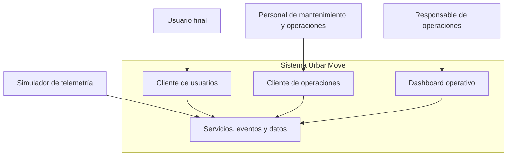

# Vista de contexto de UrbanMove

UrbanMove presta servicios de movilidad urbana con bicicletas y patinetes eléctricos. El límite del sistema comprende las tres interfaces, los servicios operacionales, el procesamiento de eventos y la capa analítica.

## Actores e interacciones

| Actor | Interacción principal |
|---|---|
| Usuario final | Consulta vehículos, gestiona reservas, realiza viajes y consulta su historial. |
| Personal de mantenimiento y operaciones | Atiende incidencias, interviene vehículos y ejecuta órdenes de recolocación. |
| Responsable de operaciones | Consulta indicadores de flota, demanda, actividad y salud del sistema. |
| Simulador de telemetría | Envía mediciones de batería y uso para desencadenar el flujo de mantenimiento. |

El simulador representa la fuente externa de mediciones durante la demostración. El coste de los viajes se calcula de forma simulada dentro del sistema.

Esta vista identifica actores y límites. La distribución de los microservicios, funciones, colas, bases de datos y Data Lake se describirá en la vista de contenedores o despliegue.